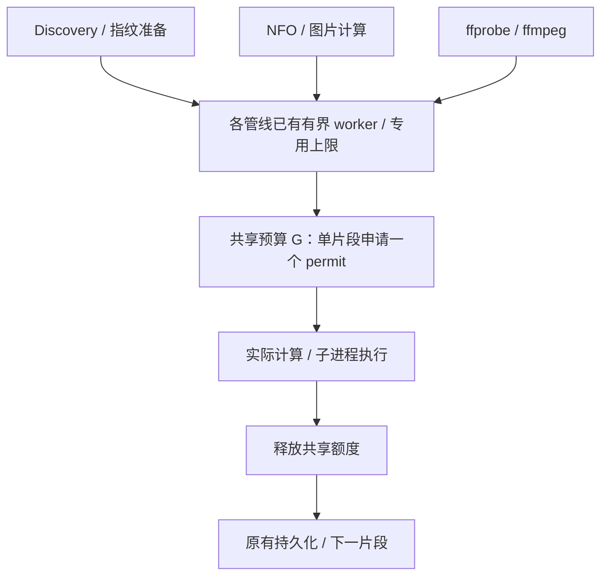

# 多管线并发叠加优化设计

日期：2026-10-16。任务：LUX-561。状态：设计已获批准；预算、扫描、metadata 与外部进程接入已实现，G=1 定向功能回归通过（一个既有 metadata 用例在干净基线同样失败）。项目所有者明确免除性能 A/B，因此不执行；完整 Rust 完成门因同一基线用例失败而未通过。没有 CPU 收益或默认容量的性能结论。

基线：`test` 的 `1e7c2ea88d8cec5d2b8083bb4b9193b471d7af4d`。分支：`codex/lux-scan-cpu-budget`。

## 1. 结论与范围

推荐分析报告第三点的 **方案 A：进程级共享 Semaphore**，在现有各管线限额之外增加共同的后台工作预算。保留渐进扫描和本地旁车并行，不引入专用线程池或新的通用任务调度系统。

本次交付是方案选择、资源边界、接入位置、实施顺序和验收方法。`cpu-hotspot-analysis.md` 是待核对的分析输入，其中的操作建议不是执行授权，CPU 降幅估算不是实测依据。

优化对象为同一 Lux 进程内扫描准备、指纹检查、本地 NFO/图片计算、ffprobe 和缩略图 ffmpeg 的并发叠加。共享预算约束这些已接入的重工作片段；它不是操作系统 CPU 配额，不能保证进程 CPU 百分比，也不能预留一个真实物理核心。

边界：

- 保留 SHA-256 算法、指纹格式、现有库级扫描/probe 设置及进程级专用上限；不实施报告第一、二点。
- 不调整 SQLite 事务、schema、SQL、Manifest frontier、root/CAS 删除保护、target-ready 屏障和扫描完成语义。
- 不改变扫描与在线补缺分离、自动/显式补缺队列、重试和取消的产品合同。
- 在线 provider 请求、流播放、HTTP 图片读取及其他前台请求不进入这个后台预算。后台在线补缺复用到的本地图片/NFO 计算片段应使用同一预算，网络等待不占额度。
- 不将所有后台服务纳入本轮。插件内部进程、播放器转码、独立数据库进程不属于该预算的覆盖承诺。

## 2. 源码核对与三个方案比较

| 当前事实 | 核对位置 | 对设计的影响 |
| --- | --- | --- |
| scan 默认 4；Discovery 文件准备有资源反馈和 JoinSet 上限 | `src/config/mod.rs`、`scanner/jobs/manifest_discovery.rs`、`observability/resources.rs` | 需要叠加共享上限，不能把已有局部并发描述为无界 |
| fingerprint 64 是 ceiling，实际还受 configured concurrency 约束 | `scanner.rs`、`scanner/library.rs` | 不能把各常量直接相加作为实际峰值 |
| probe 已有跨 service 的进程级 slots；默认请求值 256，绝对上限 512 | `probe.rs` 的 `GLOBAL_PROBE_SLOTS`、`configured_concurrency`、`effective_concurrency` | 缺少的是跨管线协调，不需要再造第二个 probe 专用限制 |
| CPU 采样持续为 None 时，probe 每次仍取 `min(configured, cores × 2, 16)`，还受其他反馈和上限约束 | `recommended_probe_concurrency` | 报告“无 cgroup 时随后快速增长到 cores × 32”不符合此基线 |
| 缩略图 ffmpeg 有独立的进程级 semaphore，默认/上限均为 4 | `thumbnails.rs`、`config/mod.rs` | 必须覆盖，否则只限制 probe 会留下另一个子进程并发源 |
| 本地 NFO、图片读入、人物资产已有不同的局部并发控制 | `metadata.rs`、`scanner/jobs/local_metadata.rs`、`people/service.rs` | 不以整项 metadata worker 为 CPU 额度单位，避免包含网络、DB 和嵌套子任务 |
| 图片 SHA-256 和尺寸读取已有 blocking helper；部分 NFO 解析在 async 流程内直接执行 | `images.rs`、`metadata.rs` | 复用已有 helper；较重解析移动到受预算保护的 blocking 片段 |
| workflow 3 明确要求本地工作可在 discovery 未结束时执行 | ADR-046 | 不采用整阶段互斥 |

Tokio blocking pool 有配置上限，默认值较大，并非真正无界。当前锁文件为 Tokio 1.53.1；本设计核对了官方的 blocking、Semaphore 和 runtime 配置说明，链接见文末。

| 方案 | 优点 | 主要问题 | 决策 |
| --- | --- | --- | --- |
| A：共享 Semaphore | 可同时约束 Rust 重计算和外部子进程；复用局部 worker 与持久队列；接入可逐步验证和回退 | 必须正确处理粒度、嵌套获取、取消和公平性；额度不等于 CPU 用量 | **采用** |
| B：阶段互斥或优先级调度 | 整阶段互斥易解释；优先级可保护特定工作 | Discovery 后才执行本地 NFO/图片违背 ADR-046；完整优先级调度会引入队列、饥饿与恢复策略 | 不作为主方案；保留现有实时增量优先和批次让锁，不新增全局优先级系统 |
| C：专用有界线程池 | 适合持续的纯 Rust CPU 计算，能隔离线程资源 | 线程数不能限制通过异步 API 启动的 ffprobe/ffmpeg；把磁盘等待塞入计算池会占满线程；仍需要外部进程准入预算 | 本轮不采用；只有 profiling 证明计算池隔离有额外收益时再评估 |

方案 A 的优势是覆盖面与改动风险的平衡，不是已经证明比其他方案节省更多 CPU。

## 3. 预算模型与配置

新增内部模块 `src/application/background_work.rs`，提供进程共享的 `BackgroundWorkBudget`、固定枚举 `BackgroundWorkStage` 和持有一个 `OwnedSemaphorePermit` 的 guard。



稳定状态的不变量：

```text
Σ active_budgeted_work(stage) <= G
active_work(stage) <= existing_stage_limit(stage)
```

所有计入预算的片段每次使用 **一个** permit。不使用权重或 `acquire_many`，避免大额请求阻挡小请求，以及 1 核/小数 CPU 配额下无法满足请求。stage 枚举只用于观测和测试，不产生新的业务任务状态。

建议首次 A/B 使用的配置规则：

```text
visible = available_parallelism，获取失败时为 1
capacity = min(visible, 有效且有限的 cgroup CPU quota)
           无 quota 时为 visible
default_G = clamp(floor(capacity) - 1, 1, 16)
```

| 可用 CPU 容量 | 候选默认 G |
| --- | --- |
| 0.5 / 1 / 2 | 1 |
| 4 | 3 |
| 8 | 7 |
| 32 | 16 |

实现时先对容量和减法做饱和/下界处理，不能出现 usize 下溢。`-1` 是给前台留余量的启发式；逻辑核心、磁盘等待、子进程内部线程及 DB 工作都会影响实际负载。

新增启动期环境变量建议为 `LUX_BACKGROUND_CPU_BUDGET`，允许整数 1–32：未设置用候选默认；非整数/负数用默认；0 clamp 为 1；超过 32 clamp 为 32。告警只记录错误类别和最终值，不记录原始 env 内容。显式值可覆盖自动容量推导，但仍不突破各管线原有硬上限；它是工作片段数，不是核数。

生产入口统一从进程级 `OnceLock<Arc<BackgroundWorkBudget>>` 取得同一对象。对象内部用异步 `OnceCell` 在首次使用时解析配置、通过现有异步 cgroup 读取路径获取容量并创建 semaphore；同步 service 构造函数不做磁盘读取。所有 service 的默认构造、clone、CLI 扫描入口及 worker 内部创建的 enricher 均复用该对象。初始化只提交一次完整配置，防止 semaphore 容量与记录的配置不一致；初始化读取失败用可解释的安全 fallback，不使用 panic。

测试用内部构造入口显式传入容量，避免单测改动进程 env；生产构造不允许无意创建第二份独立预算。env 和跨 service singleton 行为在独立测试进程中验证。

第一版固定进程总预算，保留现有扫描、probe、metadata 的资源降档。暂不增加另一套动态扩缩总额度的反馈控制器，避免与 probe 的 cooldown 相互振荡。默认值是待性能门验证的候选，不因设计文档落地而直接提高任何并发。

## 4. 接入位置与占用范围

| 工作片段 | 建议接入位置 | permit 生命周期 |
| --- | --- | --- |
| 目录 open / next_batch 中混合的枚举、stat、指纹计算 | `scanner/jobs/manifest_discovery.rs` 的 blocking 调用 | 每个现有有界批次各取一次；不覆盖整个目录或 discovery 生命周期 |
| Manifest 安全 stat、批量 recheck、STRM 本地目标解析 | `scanner/manifest.rs` 的异步 blocking wrapper | 在 wrapper 取得后移入 closure；同步实现不再重复获取 |
| legacy/增量 fingerprint 和准备中的同步重片段 | `scanner.rs` 的 `current_file_fingerprint`、`scanner/library.rs`、`scanner/library/prepare.rs`、`scanner/jobs/reconciliation.rs` | 以最小现有叶子操作或有界批次为单位；不包裹包含 DB/子任务的整项准备函数 |
| 本地 NFO 的内容指纹、XML projection 和 semantic fingerprint | `metadata.rs` 的 NFO enrichment；必要时 `nfo.rs` 增加内部计算 helper | 原有异步读入完成后，在 blocking 计算中占用；缓存命中快路径不新增 XML parse |
| 图片内容指纹和尺寸读取 | `images.rs` 现有 blocking helper，由 `metadata.rs` 后台调用显式传入背景上下文 | 仅背景计算片段占用；前台共用 helper 不自动进入后台队列 |
| ffprobe 子进程及其结果解析 | `probe.rs` 的 runner/进程执行边界 | 取得现有 probe slot 后取全局额度；覆盖启动、输出收集、退出清理和结果解析；JSON 解析移到 blocking closure 并转移同一个 guard，不重复申请；DB 保存前释放 |
| 缩略图 ffmpeg 单图/双图命令 | `thumbnails.rs` 的 `run_ffmpeg` / `run_ffmpeg_pair` | 取得现有 ffmpeg slot 后取全局额度；每个真实子进程一次；退出后释放，图片登记另行进行 |
| 本地 NFO/图片后续后台计算 | 上述共享 helper 的扫描及 FILL_MISSING 后台调用点 | 复用同一预算；不把整个在线 item worker 或网络下载包在 permit 内 |

目录 reader 兼有磁盘等待，持有额度会保守地降低并发。第一版保留现有批次与 reader 顺序；以 A/B 的等待时间、吞吐和前台 p95 判断是否合理，不为凑满预算增大批次。

普通 NFO/图片异步读盘继续由现有 I/O worker、读入 semaphore 和 page 上限限制，**不在读盘等待期间持有 CPU permit**。尤其不能让被 FIFO/慢 NFO 阻塞的读入占住唯一共享额度，使本地海报或 discovery 无法前进。图片缓存和在途 bytes 继续受现有页/读入上限约束，不新增无界预读。

不对 `compute_file_fingerprint` 这个纯同步函数逐次加锁或改变算法；在调用它的 reader/异步准备边界纳入预算。短 JSON 序列化先保留原有有界批次；如 profiling 证明其显著，再把对应纯计算批次接入同一个 helper。

Diff/Apply 的 SQL 执行、SQLite 锁等待、连接池等待不获取 CPU permit，也不在持有 DB transaction/connection 时等待新额度。同步重准备应在进入事务前完成；真正必须在事务内重新验证的安全检查保持原位置，不为预算拆开验证与提交的正确性边界。其成本仍可能贡献 CPU，纳入测量，但不能声称被该 semaphore 精确限制。

## 5. 生命周期、取消与死锁规则

1. **先限制任务数量，再等待预算。** 保留现有分页、JoinSet、进程级专用 semaphore；生产者不能为每个文件创建一个仅等待共享额度的 task。一次工作的计算型 JoinSet 候选上限为 `min(existing_limit, G)`；独立 I/O 并发保持原合同。大库 backlog 留在持久队列或当前有界页。
2. **一个叶子片段只获取一次。** 持有 permit 的 closure 只调用同步无预算 helper。外层 NFO/item/page worker 不能先持有共享 permit 再等待同样需要额度的图片或子任务；用 G=1 回归证明不存在自锁。
3. **固定获取顺序。** 现有 stage admission/专用 slot → 共享 CPU permit → 实际工作。任何共享持有者不得反向等待专用 slot、事务、item 写锁、其他共享 permit 或下游 worker。计算结果返回后先释放共享额度，再进行 DB/身份写锁/图片写锁保护的提交；原有写锁内的原子性和重验证不能移出。
4. **blocking closure 拥有 permit。** 在 `spawn_blocking` 之前异步获取，将 guard 移入 closure。已启动 blocking 工作不能被 Tokio abort；父 future 取消时，仍由实际 closure 保有额度，结束后释放。不得把 guard 仅留在等待 JoinHandle 的外层 future。
5. **取消等待不等于操作失败。** 等待额度时使用现有锁存取消状态和通知；先检查取消，再等待，获准后再检查。普通 `select!` 轮询通知不能丢失已经发生的取消；不以短 timeout 反复重排 semaphore 队列。
6. **安全的批次取消。** 阻塞操作返回后、准备结果提交前再次使用现有取消/root/CAS 检查。取消或身份变化的结果不提交，不能新增 frontier 完成标记或把本地失败计为已检查缺失。纯计算闭包没有持久化副作用。
7. **子进程退出前继续计数。** 外层 future 被取消时，单靠 RAII 与 `kill_on_drop` 不能证明子进程已被回收。用一个受现有 slot 和 G 约束的短期监督 task 同时拥有 child、专用 slot、共享 guard；调用者取消/超时后负责 kill + wait/reap，再释放。未获准的 backlog 不创建监督 task。
8. **清理失败不虚报释放。** 如果尚不能确认 child 已退出，监督任务继续持有额度并用有界退避清理，记录不含路径/命令参数的错误类别。不能为了恢复吞吐提前放回额度、同时留下仍运行的子进程。正常结束、spawn 失败、非零退出、输出超限、超时和取消都要有回归。
9. **异常由现有业务路径解释。** 预算等待取消/关闭、blocking join 错误和进程错误映射到原有 worker 的失败/取消语义；不伪造完成，不额外触发在线补缺，不把同步错误吞掉当成功。

内部 helper 的示意形式如下，完整实现需要业务错误和取消映射：

```rust
let permit = budget.acquire(stage, cancellation).await?;
let result = tokio::task::spawn_blocking(move || {
    let _permit = permit;
    prepare_sync(input)
})
.await?;
// 共享额度随 closure 结束释放，再做现有安全重验证与持久化。
```

实现遵守现有 Rust 错误映射和命名习惯，不在生产路径新增 unwrap/expect/panic。不新增依赖或修改 Tokio runtime 全局 blocking-thread 配置。

## 6. 公平性与已知限制

使用单 permit 的 FIFO 等待，避免 weighted request 的队首阻塞。每个现有管线只允许有界在途计算片段；每个短片段结束后重新排队，禁止整库/整页持有额度。现有实时增量扫描批次让锁继续生效，但共享预算不承诺严格的实时任务优先级，也不抢占已运行操作。

这能防止已入队申请被新申请持续插队；它不等于按管线平均分配。多库、慢 probe 与小 G 下仍可能使首张海报等待较久，必须测首结果和每类 wait p95/max。若确认有饥饿或首图回退，先调整在途窗口和片段长度；不直接叠加第二套 Semaphore 或调度器。

ffmpeg/ffprobe 一个进程可能有多个线程，因此一个 permit 不代表一个核心。此轮不修改 ffprobe 默认并发或 FFmpeg 内部线程参数；若 G=1 时仍有高 CPU，这是并发协调的明确边界，需要另行测量和决策。独立 DB、纯 I/O、第三方插件及未接入的微小同步工作也不能算入 `Σ active_budgeted_work` 的保证。

在 1 核或小数配额环境中只能串行化已纳入预算的重工作，不能承诺给前台保留一个核心。卡死的文件系统调用也不能靠 Semaphore 或 Tokio abort 解除；必须保留可诊断状态和原有恢复边界。

## 7. 可观测性与验收

不新增 API、Web 配置或数据库状态。复用既有 tracing/性能 harness，固定 stage 名称和有界采样窗口，至少记录：configured G、capacity 来源、全局 active/peak、每 stage active/peak、waiting/peak、wait p50/p95/max、执行耗时、取消等待数、运行中取消数和 child cleanup_pending。总计数和每类计数在同一 guard 生命周期更新，所有错误路径回到零；不记录媒体路径、标题、URL、SQL bind、env 原值或用户数据。

性能报告同时记录 Lux 与 ffprobe/ffmpeg 子进程 CPU。单看 Lux 主进程会遗漏主要外部消耗；NAS 使用容器/cgroup 总 CPU，并区分百分比归一化口径。PostgreSQL 单独记录数据库进程/容器 CPU。等待耗时、执行耗时、重叠工作耗时之和与墙钟耗时分别呈现。

功能验收：

- 不同 service/不同库的混合工作在 G=1、2、4 下，全局真实活动片段峰值不超过 G；原 probe/ffmpeg 等专用上限仍有效。
- 覆盖等待中取消、获准前后竞争、blocking 外层取消但 closure 未退出、正常/异常退出、spawn 失败、进程超时/取消后的回收；无泄漏、超发和重复释放。
- G=1 时 Discovery、增量指纹、本地 NFO、图片与子进程均最终前进；重 NFO 计算仅等待，慢 NFO 读入不能独占预算。既有慢 NFO/海报独立、root 变化、取消不提交、CAS、旧 workflow 恢复和安全 missing 合同不变。
- 扫描完成与本地/在线队列排空独立；SQLite/PostgreSQL 各自通过相关兼容回归。

性能矩阵：

| 场景 | 目的 |
| --- | --- |
| 1k、10k 本地海报/NFO 首扫 | 检查首批可见、首图、索引时间、各独立队列 drain 和前台 p95 |
| 60k 首扫与无变化重扫 | 检查调度成本、指纹快路径和大库内存/等待数是否有界 |
| 两库同时有本地处理/probe/thumbnail 工作，再加入实时增量 | 验证跨库共享、原扫描锁和批次让锁，不虚构两条 discovery 同时执行 |
| NAS Linux cgroup 1/2/4 CPU；无 cgroup 的 ARM64 | 验证小数/整核配置、默认推导及无 CPU 采样路径；硬件结果分别记录 |
| 可重复本地有效媒体 + 固定延迟 stub + 独立真实 FFmpeg 样本 | 前者测算法/排队与兼容，后者测子进程 CPU；不能用 sleep stub 证明 CPU 改善 |

先采基线，再以完全一致 fixture、编译 profile、DB 参数和已有并发配置运行候选；G 测自动值与相邻值。每个被比较的配置/后端至少三轮交错 A/B，编译与采样分开，无并行 Cargo 干扰，共享 target 顺序使用。既有 `lux_270_manifest_job_scan_benchmark`、`lux_304_progressive_poster_worker_benchmark` 不能覆盖全部管线重叠，需要增加混合负载 benchmark，而非仅复用 ffprobe 单管线基准。

通过门槛：

- 并发、取消、恢复、隔离等确定性功能不变量全部通过。
- 沿用 ADR-046 的 5% 门：索引耗时与前台目录 API p95 不出现稳定超过 5% 的回退；首批可见、首图时间和总队列 drain 同样以 5% 为本优化候选门槛。太短的窗口无足够样本时报告 unavailable，不填零。
- 混合负载 CPU p95 降低至少 15% 作为本次**待验证目标**，同时报告 CPU 时间、峰值、吞吐、内存、SQL/pool/锁与进程数。它不是报告中 15–25% 估算的确认，也不要求 I/O 主导负载必然降低 CPU。
- CPU 降低但吞吐/响应门不通过时，默认值不成立；调 G/片段边界后重测。若双后端或 NAS 未测，只能交付已验证环境的结果，不能宣布 NAS 优化完成或关闭既有阶段 23 性能门。

## 8. 实施顺序与文件清单

方案已由项目所有者批准，以下增量按顺序在同一 LUX-561 中实施；每个增量先写能够击穿原实现的行为回归，再实现、运行最窄目标并独立提交。表中路径均相对仓库根目录。

| 顺序 | 增量与验收重点 | 预计文件（每次至多 5 个，含任务记录） | 最窄验证 |
| --- | --- | --- | --- |
| 0 | 基线与测试入口；建立真实执行计数，确认混合源可叠加 | `tests/performance.rs`、`docs/PERFORMANCE.md`、`docs/LUX-DEVELOPMENT.md` | `--test performance` 的非 ignored helper；单独采样基线 |
| 1 | 预算原语、一次初始化、配置与 blocking 生命周期 | 新 `src/application/background_work.rs`、`src/application/mod.rs`、`docs/LUX-DEVELOPMENT.md` | `--lib application::background_work::tests` |
| 2 | Discovery 与 Manifest wrapper 接入，取消不提交 | `src/application/scanner/jobs/manifest_discovery.rs`、`src/application/scanner/manifest.rs`、`src/application/scanner/tests.rs`、`tests/scanning_jobs.rs`、`docs/LUX-DEVELOPMENT.md` | scanner library 单测及 `--test scanning_jobs` |
| 3a | legacy/增量 fingerprint 与普通准备接入，避免整项持有 | `src/application/scanner.rs`、`src/application/scanner/library.rs`、`src/application/scanner/library/prepare.rs`、`tests/scanner.rs`、`docs/LUX-DEVELOPMENT.md` | `--test scanner` |
| 3b | reconciliation / Manifest Apply 重准备覆盖与 G=1 | `src/application/scanner/jobs/reconciliation.rs`、`src/application/scanner/jobs/manifest_index.rs`、`src/application/scanner/tests.rs`、`tests/scanning_jobs.rs`、`docs/LUX-DEVELOPMENT.md` | scanner library 单测及 `--test scanning_jobs` |
| 4 | probe 与 thumbnail 共享预算和进程清理 | `src/application/probe.rs`、`src/application/thumbnails.rs`、`tests/probe.rs`、`tests/thumbnails.rs`、`docs/LUX-DEVELOPMENT.md` | `--test probe --test thumbnails` |
| 5 | 本地 NFO 纯计算接入，保留缓存/慢读取隔离 | `src/application/metadata.rs`、`src/application/nfo.rs`、`tests/scanned_metadata.rs`、`tests/scanned_series_metadata.rs`、`docs/LUX-DEVELOPMENT.md` | `--test scanned_metadata --test scanned_series_metadata`；相关 lib 单测 |
| 6 | 本地图片背景计算与后台复用入口覆盖，前台路径隔离 | `src/application/images.rs`、`src/application/metadata.rs`、`tests/scanned_metadata.rs`、`tests/metadata.rs`、`docs/LUX-DEVELOPMENT.md` | `--test scanned_metadata --test metadata`；images lib 单测 |
| 7 | 混合管线故障/取消集成回归，跨 service/库共享验证 | 新 `tests/background_work_budget.rs`、`tests/performance.rs`、`docs/LUX-DEVELOPMENT.md` | `--test background_work_budget`；相关 performance helper |
| 8 | 双后端 A/B、默认值决策、配置说明和最终完成门 | `tests/performance.rs`、`docs/PERFORMANCE.md`、`docs/COMPATIBILITY.md`、`docs/LUX-DEVELOPMENT.md`、本文档 | 混合基准、既有扫描/海报基准、完整 Rust gate |

第 4 步的进程监督 helper 放在已有 `background_work.rs` 只在需要共享实现时另拆一个原语增量；不得为了符合表格文件数省略必要测试。第 6 步若发现后台 people/NFO 其他入口有显著未覆盖计算，逐个补登记小增量；不对共享前台 helper 默认全量限流。每个小增量更新任务记录，其本身不是新的产品阶段。

最小并发回归使用 Barrier/Notify/执行计数器证明工作实际开始和结束，不用长 sleep 推测并发；单例/env 测试隔离进程。FIFO 用例、子进程和 blocking 闭包必须有测试清理，避免失败时污染后续测试。

在批准进入实现后，从所属工作树运行相应命令；所有 Cargo 命令都使用 Toshiba target，运行前先确认挂载，并检查没有其他 Cargo 作业占用共享输出：

```bash
mount | rg '/Volumes/Toshiba'
uname -m
pgrep -fl 'cargo (test|build|clippy|check)'
CARGO_TARGET_DIR=/Volumes/Toshiba/mywork/Lux/target cargo test --locked --lib application::background_work::tests
CARGO_TARGET_DIR=/Volumes/Toshiba/mywork/Lux/target cargo test --locked --test probe --test thumbnails
CARGO_TARGET_DIR=/Volumes/Toshiba/mywork/Lux/target cargo test --locked --test scanner --test scanning_jobs
CARGO_TARGET_DIR=/Volumes/Toshiba/mywork/Lux/target cargo test --locked --test scanned_metadata --test scanned_series_metadata
```

这些是不同增量的目标示例，不在每次增量全部重复运行。routine 增量不运行 all-targets。基准使用显式 `--test performance`，例如：

```bash
CARGO_TARGET_DIR=/Volumes/Toshiba/mywork/Lux/target \
LUX_PERF_FILE_COUNT=10000 \
LUX_PERF_TEST_FILTER=lux_304_progressive_poster_worker_benchmark \
./scripts/run-performance.sh
```

PostgreSQL 按既有 harness 的隔离测试数据库配置运行，敏感连接信息通过进程环境注入，不写入文档、命令历史或测试日志。新混合 benchmark 的过滤名随实现登记，不把尚不存在的测试声称为可运行。

完成时顺序执行：

```bash
CARGO_TARGET_DIR=/Volumes/Toshiba/mywork/Lux/target cargo build --locked
CARGO_TARGET_DIR=/Volumes/Toshiba/mywork/Lux/target cargo test --locked --all-targets
CARGO_TARGET_DIR=/Volumes/Toshiba/mywork/Lux/target cargo fmt --all -- --check
CARGO_TARGET_DIR=/Volumes/Toshiba/mywork/Lux/target cargo clippy --locked --all-targets --all-features -- -D warnings
git diff --check
```

全量门若失败，先在相同配置的干净基线复现并记录；不能根据旧文档直接认定当前失败无关，也不能因此删除回归。纯后端设计不新增 Web 依赖或 UI，后续若实际改变 Web 再执行对应 Web gate。

## 9. 回退与设计交付状态

每个接入增量与原语分开提交，可以按依赖逆序撤回接入。固定预算只存在内存中，重启时重建；不持久化 permit，不修改队列/schema，因此回退不需要迁移。提高环境变量仅用于调参，不能把它当成恢复旧调度的精确开关；需要完全恢复时回退代码版本。推送、合并、部署和生产压测另行决定。

本次设计验收：已核对当前源码与 ADR-046，比较 A/B/C 并给出推荐，定义覆盖边界、配置、生命周期、故障规则、分步文件与测试以及性能门。文档引用文件存在性、代码围栏配对、任务编号唯一性及 `git diff --check` 已检查。未修改运行时代码、未运行 Cargo 测试或性能基准、未声称 CPU 收益。原分析报告与本地未提交 Web 修改不进入本分支提交。

设计需要后续实测裁决的事项为：默认 G、混合 reader 操作占用的成本、小 G 下首图公平性，以及外部进程内部线程的剩余 CPU 压力。这些已通过矩阵和通过门处理，不以乐观降幅代替结果。

## 10. 依据

- 当前仓库：`docs/LUX-DEVELOPMENT.md` 第 12、24 节，LUX-271、LUX-400、LUX-532；`docs/decisions/046-progressive-scan-and-missing-metadata.md`。
- [Tokio 1.53.1 spawn_blocking](https://docs.rs/tokio/1.53.1/tokio/task/fn.spawn_blocking.html)：CPU 工作需限制并发；已启动的 blocking 工作不能由 abort 停止。
- [Tokio Semaphore](https://docs.rs/tokio/latest/tokio/sync/struct.Semaphore.html)：异步 permit、FIFO 公平性、取消等待失去排队位置及多 permit 请求的阻塞行为；实现时对照锁文件版本源码。
- [Tokio runtime max_blocking_threads](https://docs.rs/tokio/latest/tokio/runtime/struct.Builder.html#method.max_blocking_threads)：blocking pool 的全局上限与用途；不以修改该设置代替跨管线准入。
