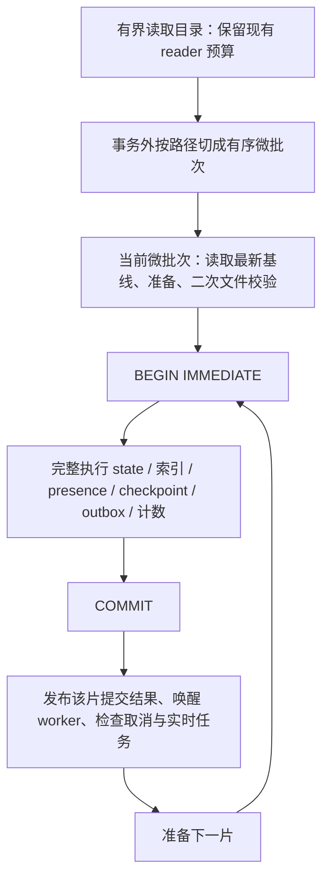

# SQLite discovery 写事务优化方案

日期：2026-10-16。状态：已实施候选优化并将 SQLite 完整写事务默认值选为 4,000；完整 all-targets 与 PostgreSQL 门仍未全部验证通过，详见 LUX-564。

设计基线：`test` 的 `1e7c2ea8`。工作分支：`codex/sqlite-short-write-transactions`。
范围：用户提供的 `cpu-hotspot-analysis.md` 第四点，仅优化 Manifest discovery 的 SQLite 写事务。
本文不改变现行产品规格；实施按 `LUX-DEVELOPMENT.md` 中的 LUX-564 登记范围执行。

## 1. 结论与三个方案的取舍

**首选 B：保留 WAL，独立限制每个完整写事务的数据量。A 只采用按数据分片的形式；C 暂不引入临时表。**

目录读取、文件准备、SQL 参数分片和数据库事务是四种不同的批次。当前读取最多约 8k 文件，不意味着必须在一个事务中写完这 8k 文件。推荐增加独立的 SQLite 提交预算，依次准备和提交微批次；每个微批次仍完成全部一致性步骤。

| 附件建议 | 评价 | 本方案决策 |
|---|---|---|
| A：把七个步骤分开提交 | 会破坏索引、presence、frontier、计数和 outbox 的原子性，存在恢复遗漏和错误删除风险；与 ADR-043/044/045 冲突 | 不采用按步骤提交。采用“数据分片后，每片完整提交”的安全变体，与 B 合并 |
| B：WAL + 更小批次 | WAL 已启用；减小单次事务的数据量直接缩短连续占用写者的窗口，复杂度相对可控；额外提交会损失吞吐 | 主方案。比较 512、1024、2048、4000 与现行 8000 文件预算，实测选择生产默认值 |
| C：临时表 + INSERT SELECT | format 3 已不写逐文件完整 observation；现有路径也已有 VALUES CTE 和集合写入。临时表额外增加装载、连接生命周期与清理成本，ADR-043/044 当前不依赖这种路径 | 不作为首轮实现。保留集合 SQL 的思想，仅对测得的热点继续优化现有 CTE/批量写入 |

不预先认定 1024 最优，也不承诺附件中的 5–10% CPU 降幅。最终决策优先考虑其他写请求的延迟，并同时守住扫描吞吐和现有性能门。

## 2. 当前实现核查与证据边界

- `src/storage/repository.rs`：每个 SQLite 连接设置 WAL、外键与 `busy_timeout=5000`；`begin_scan_write_transaction()` 使用 `BEGIN IMMEDIATE`。WAL 仍然只允许一个写者，[SQLite WAL 文档](https://sqlite.org/wal.html#concurrency)明确说明这一点。
- `src/application/scanner.rs`：streamed 文件预算为 8000，entry 预算为 8192，非 streamed reader 为 1024，子目录预算为 200。`jobs/manifest_discovery.rs` 合并多个目录块后，在 storage 开启一次事务。SQL 内部的 `.chunks(...)` 只限制语句参数量，不释放整个事务的写者资格。
- `src/storage/jobs/scan/manifest/discovery/coordinator.rs`：事务涵盖 state/frontier、known-path、目录完成、root checkpoint/observation、正向索引、local metadata outbox、presence 与计数。输入验证已经位于事务外，文件 stat、STRM 读取和准备也已主要在 application 层执行。
- 当前新 Manifest 为 `(workflow_version=3, discovery_format_version=3, discovery_mode=LITE)`。format 3 只保存所需目录 observation；Lite 进一步只保留 root observation。旧 format/workflow 的兼容路径仍存在，不能依据附件描述把整个热点归因于 observation INSERT。
- `checkpoint.rs` 已有 `WITH incoming AS (VALUES ...) INSERT ... SELECT`；`presence.rs` 已有批量 fingerprint CAS 和紧凑 seen-path 集合写入；`indexes.rs` 的 ADD 路径已有批量 materialization。优化前必须知道实际慢在 ADD、CHANGE、unchanged CAS、派生索引还是 commit。
- `transaction_begin` 当前包括 pool 获取及 BEGIN 等待；`transaction_total` 也包括 BEGIN 等待。两者都不能直接当作“持锁时间”。已有 `lux::scan_performance` 阶段采样和 `tests/performance.rs` 可以复用。
- `SCAN_LOCK_DATABASE_WAIT_BACKOFF_MS=[10,20,40,80,160,250]` 用于扫描优先级和 target materialization barrier 等待，调用 `tokio::time::sleep`。真正的 SQLite 锁冲突重试在 `run_batch_with_failure_handling()`，延迟为 250/750/1500 ms，最多三次。不能把前者直接当作 SQLite BUSY 导致的忙循环；SQLite 自身的 [busy timeout 也通过 sleep 等待](https://sqlite.org/c3ref/busy_timeout.html)。
- `docs/PERFORMANCE.md` 曾记录 8k→16k 实验：batch p95 308→588 ms、无变化重扫约慢 11.4%，因此恢复 8k。这支持重新评估事务预算，但这是历史 ARM64 fixture 数据，batch p95 也不是写锁时间，不能当成本轮 NAS 诊断或优化结果。

本设计最初只基于源码、规格及历史记录提出实验方案；随后完成的 release A/B 与当前选择记录在 `docs/PERFORMANCE.md` 的 LUX-564 章节。附件中的“事务数百毫秒至数秒”和“间接 CPU 开销”不作为已证事实；本机 ARM64 fixture 结果也不外推 FNOS/NAS。

## 3. 事务边界与执行流程



### 3.1 分开四类预算

1. **Reader / 内存预算**：保持当前目录 reader、在途 entry 上限与目录组顺序，不增加 reader 或 writer 并发。
2. **准备预算**：仅准备即将提交的微批次，不提前把整个 8k 块的数据库基线固化后再长时间排队。
3. **事务预算**：增加 application 层内部 policy，根据后端选择；SQLite 候选如上，PostgreSQL 首轮继续使用现行预算和相同事务状态机。
4. **SQL 参数预算**：继续使用 storage 的 backend-aware bind 上限；事务变小不代表可以取消 SQL 分片。也不把 SQLite 小事务预算误用成所有 SQL 的全局 chunk size。

候选文件数之外，还要独立限制总 entry、子目录与 completion 数。首轮保留现有子目录 200、目录组 80 的上限，为每档给出一致的总 entry 上限并覆盖纯目录输入；不能只统计 positive files，放过大量 unchanged 文件或目录事件。文件数和所有计数都按多块合并后的事务输入计算。

第一轮使用固定预算，基准通过现有 `performance-benchmarks` feature 下的测试入口注入候选值。暂不增加用户配置、动态调参器、全局数据库 writer actor 或新的持久化 schema。

### 3.2 安全分片规则

- 在 `PendingManifestDirectoryChunk` 阶段、正向索引准备之前分片。以 observation 路径为数据单元，DIRECTORY observation 与对应 child frontier 同片；准备后生成的 positive、unchanged、seen-entry 只属于本片。
- 同一事务仅包含同一 manifest/job/root。保持现有遍历与提交顺序；不额外重排同一影片版本、季度、分集或父目录。
- 同一目录跨多个微批次时，`completed_directory` 只放在最后一片。最后一片成功前，旧 PERSISTED frontier 必须仍可恢复；其子目录注册必须在父目录完成前落库。
- root/directory 的内存 identity 证据随分片保留；持久 observation 按原始输入恰好分配一次，不为每片复制 root observation。空目录、目录结束标记也必须能独立组成有界事务。
- 一片准备前重新读取本片数据库基线，紧邻提交执行现有文件与 root/directory 二次校验；事务内继续复核 manifest/job 状态和 fingerprint CAS。前一片提交与后一片准备之间的增量更新不能被旧基线覆盖。
- 每片都独立完成 frontier、root sequence 预留、索引、generation/presence、workflow-3 outbox 和计数。outbox 继续每批最多 256 sources；source 列表及 batch sequence 与该片索引同事务持久化。
- 同一片失败则整片回滚。此前成功片保留，后续片停止；不把前几片的内存成功结果丢掉后继续扫描。外层现有批次重试可重新遍历，但必须证明已提交路径的计数、sequence、outbox 和 targets 不重复。
- 特别覆盖“前片已提交，但路径因 CAS 冲突仅进入 seen-path ledger”的重放。`ON CONFLICT DO NOTHING` 只证明行不重复，不能直接证明计数幂等；若现有 known-path 判定不足，单拆存储增量，以事务内已提交事实判定重复观察，再推进微批次默认值。
- 保持 storage 的 `commit_scan_manifest_discovery_chunks()` 为“传入这组数据，全成或全败”。不在此方法内部偷偷拆成多个 COMMIT，以免上层一次调用收到错误却已有未知部分成功。

### 3.3 取消、恢复与其他写者

- 每片准备前、BEGIN 前和提交后检查取消。已提交片保留；取消被观察到后不启动后续片。取消请求在一个事务执行中到达时，沿用现有事务和取消竞态语义，不额外承诺中断正在执行的 SQLite 语句。
- PERSISTED 模式按最后已提交 frontier 恢复；LITE 按当前合同从未完成 root 重新遍历，依赖 generation/fingerprint CAS 与幂等写入恢复。
- 最后一个目录片提交只代表目录读取完成，不提前设置全 root/manifest 的删除许可、target-ready 或索引完成事件。root 完整覆盖、identity、缺失二次确认、首页快照与现有 completion barrier 保持原时序。
- 提交后先结束事务、释放数据库资源，再执行通知、取消检查与下一片准备；单 writer 顺序推进。微批次提供其他写者进入的机会，但 SQLite 不保证公平，不把 `yield_now()` 当作公平性证明。
- 现有 scan semaphore 的持有范围不能靠切 COMMIT 自动缩短。对受该 semaphore 限制的实时任务，继续使用现有 yield/requeue 边界；若测量发现仍由外层调度阻塞，单列下一增量，使用持久 checkpoint 和调度回归后再改，不能在遍历中随意丢弃 frontier。
- 不增加新的重试层。保留当前有界锁错误重试和非锁错误处理；每次回退等待前确认失败事务已完成回滚/释放。连接池耗尽、业务 Conflict 与 BUSY/LOCKED 分别统计。

### 3.4 缩短事务内纯计算

在阶段采样证明占比后，把只依赖输入的路径映射、分类向量、去重/排序及可复用 SQL 模板准备到事务外；不迁出 manifest 状态读取、known-path 判定、CAS 结果判断和 sequence 分配等一致性操作。

若热点在 `positive_index_apply` 或 `presence_ledger`，优先对现有集合 SQL 做针对性改进。新增批量 CHANGE/派生索引优化必须保留逐路径 CAS 成功集合、identity 竞争和每片回滚证明；不得仅根据 affected-row 总数推断所有路径都成功。没有热点证据时不进入此项。

### 3.5 不采用的机制及原因

- **步骤间 COMMIT / 先 observation 后异步补索引**：破坏现有恢复与删除安全合同，需另行 ADR，不属于本方案。
- **SAVEPOINT 作为释放写锁的手段**：内部 RELEASE 不提交外层事务，不能达到微批次释放写者的目的，见 [SQLite Savepoints](https://sqlite.org/lang_savepoint.html)。
- **改成 DEFERRED**：会改变读后升级写事务的竞争行为；本轮保留 [BEGIN IMMEDIATE](https://sqlite.org/lang_transaction.html#deferred_immediate_and_exclusive_transactions)。
- **增加连接池、放大 busy timeout、降低 synchronous**：不能替代缩短写事务，或会改变延迟/耐久性。保持现有配置并记录实测值。
- **立即引入临时表**：收益点尚未成立。若未来现有集合 SQL 仍被证明不足，须先修订 ADR-043/044，再设计同连接装载/消费、成功及失败清理、连接回池残留隔离、内存/磁盘成本与双后端回退；另建可撤回实验，不默认进入生产。
- **本轮调整 WAL checkpoint 策略**：先区分 commit 尖峰与事务 body。自动 checkpoint 可使偶发 COMMIT 较慢，见 [WAL 性能说明](https://sqlite.org/wal.html#performance_considerations)；只有测得瓶颈后另立任务，不混入本轮事务预算优化。

## 4. 测量、候选选择和验收

### 4.1 复用现有观测，明确统计含义

| 指标 | 定义与用途 |
|---|---|
| `acquire_and_begin_us` | 调用 begin helper 到 BEGIN 返回；生产路径保留 pool + 锁等待的合并定义，不能标成纯锁等待 |
| `transaction_body_us` | BEGIN 成功到调用 COMMIT 前；观察事务内 SQL 和纯计算 |
| `commit_us` | COMMIT 调用到返回，单列自动 checkpoint/fsync 可能造成的尾延迟 |
| `transaction_scope_us` | BEGIN 成功至 COMMIT/显式回滚完成的上界；可能包含 SQLite 已释放写者之后的 commit/checkpoint 工作，不冒充底层精确锁持有时间 |
| 分阶段耗时 | 复用 state、known-path、positive ADD/CHANGE、presence、outbox、counter 等 existing stages；p50/p95/p99/max 分开汇总 |
| 其他写者等待与完成时间 | 独立连接先测 pool acquire，再测 BEGIN；再测一条真实、固定的进度/用户状态更新及 COMMIT。成功、错误、超时样本分别报告 |
| 代价 | 索引总耗时、unchanged 重扫、混合变更、前台 API p95、SQL/DML、事务数、WAL 增量/峰值、RSS、进程 CPU 时间及核归一化占用 |

失败路径也记录事务阶段、回滚完成与 outcome。仅输出阶段、数量、后端和安全错误分类，不新增路径、bind、URL、凭据或完整 SQL 日志。

现有锁 monitor 使用同一 pool 周期性 `BEGIN IMMEDIATE`，采样自身也会竞争并污染 SQL 计数。基准必须分开“无锁探针的吞吐/DML”与“有竞争写者的延迟”两组；竞争组报告探针频率和负载，不能称作完全被动观测。样本不足时报告 n/null，不把少量样本的 p99 当作稳定结论。

### 4.2 基准矩阵

1. 同机、同 fixture、同 SQLx/SQLite 版本、同并发和 PRAGMA，对照固定基线 `1e7c2ea8`；记录 `uname -m`、文件系统和实际 pool 配置。
2. SQLite 初筛预算 512/1024/2048/4000/8000；先 1k smoke，再 60k 文件/600 目录筛选。对前两名与基线至少三轮交错 A/B；缓存冷热状态一致，期间不运行 Cargo 编译或其他压测。
3. 分别覆盖首扫 ADD、unchanged 重扫、CHANGE/REAPPEARED 混合、单个超大目录、多空目录、电影/剧集/旁车，以及 workflow 3 local metadata worker 同时写库。
4. 竞争负载覆盖用户播放进度、probe/metadata 完成更新及取消请求；前台读取沿用现有目录/管理 API 测法。合成进度写者与真实服务写路径分别报告。
5. PostgreSQL 不改变默认提交预算，但仍运行相关行为测试和同配置 release A/B，检查共享分片/准备改动没有回退。旧 workflow/format 以兼容回归为主。
6. 当前机器为 ARM64；FNOS/x86_64 的同样观察留给后续目标机验证。本轮不能把本地数据外推为 NAS 结果。

### 4.3 选择规则与性能门

- 正确性必须全部通过；禁止通过取消 CAS、弱化删除确认或提前 readiness 获得性能。
- **新增设计目标，待基线验证**：有竞争时其他写者 p95 至少降低 50%；希望达到 p95 ≤100 ms、p99 ≤250 ms。这些是选型目标而非运行时 deadline。基线已明显低于绝对目标时，不要求人为制造 50% 改善，应证明无回退且预算确实降低长事务上界。
- 同 fixture 首扫、无变化重扫和前台 API p95 相对当前基线均不得回退超过 5%；batch 尾延迟不得恶化。CPU 时间、WAL、RSS 作为代价完整报告，不预填 CPU 降幅。
- 在通过上述门的候选中，选择提交次数较少且写者延迟已达标的较大预算；不机械选择最小批次。固定预算仍不能满足时，先定位具体 SQL，不自动引入自适应控制器。
- **已知冲突风险**：`tests/performance.rs::lux_270_manifest_job_scan_benchmark` 当前要求总 DML `<209`。小事务可能触发该门失败；必须保留并报告这个约束，不默默放宽数字或排除 outbox。优先选择兼顾延迟且仍通过该门的预算/优化；若全部候选无法兼顾，提交实测权衡及建议的新预算公式，等待项目所有者明确修改该合同后再推进。
- 原 LUX-275 与阶段 23 的开放性能门不因本方案测试通过而自动关闭。任何阶段门失败都保留原始结果，不能把定向通过写成完整完成。

## 5. 正确性与故障测试

使用实际文件 SQLite/WAL 和至少两个独立连接，不以单连接内存库模拟竞争。正确性测试用 barrier/通知/故障触发器同步，不用脆弱的毫秒上限断言代替事务边界证明。

| 测试组 | 必须证明的行为 |
|---|---|
| 分片边界 | 0/1/limit/limit+1/多倍 limit、混合多目录/多 chunk、只有 unchanged、纯目录/空目录；每个输入恰好一次，任何合并事务都不越预算，只有最后片携带 completion |
| 分片间写入 | 第一片提交后暂停扫描，让独立真实写者成功提交，再放行第二片；证明存在事务外窗口。另验证调度 semaphore 与数据库写锁是两种边界 |
| 原子回滚 | 在 positive、presence、outbox、counter 等后置位置注入错误，当前片的索引/sequence/frontier/ledger/计数/outbox 全回滚，前片保持可见 |
| 失败重试 | 第二片失败后重试同一 job；计数、影片版本、outbox sequence/source refs 和 targets 无重复，无后续片被提前确认 |
| 崩溃恢复 | 在片间已提交及片内未提交两处终止测试子进程，再 reopen 数据库；PERSISTED 恢复 frontier，LITE 重新遍历 root，结果和完整扫描一致 |
| CAS/身份竞争 | 片间增量 ADD/CHANGE、fingerprint 改变、版本归并、剧集层级复用；新状态不被旧基线覆盖，CAS 失败路径仍有安全 presence |
| 删除与完成 | 取消、root 替换、文件消失和目录前缀重叠均不能误删；target-ready、首页切换、ScanCompleted/JOB_COMPLETED 时点保持 |
| 提交后副作用 | 只对成功片发布结果/唤醒；失败及重试不能遗失 durable outbox，不能重复生成逻辑工作。event 语义沿用当前合同，不另增逐片公共事件 |
| 后端兼容 | SQLite 与 PostgreSQL 的存储语义一致；现有旧 workflow/format/LITE/PERSISTED 回归仍通过，PostgreSQL 默认预算不变 |

重点复用 `tests/scanning_jobs.rs` 中 discovery rollback/outbox、persisted frontier 恢复、unchanged CAS、target cursor rollback、large directory bounded chunks 等合同，而不是重写与实现结构一一对应的测试。

## 6. 实施增量、精确文件预算与验证

以下是候选实施顺序，各项在实施前分别登记 LUX 编号。每次按 TDD 完成一个增量并原子提交；若新增文件导致超出 5 个，继续拆分。本设计轮只新增本文。

| 增量 | 预计修改文件（每项最多 5 个） | 验收及验证 |
|---|---|---|
| I1：基线与事务观测 | `src/storage/jobs/scan/manifest/discovery/coordinator.rs`、`tests/performance.rs`、`docs/PERFORMANCE.md`、`docs/LUX-DEVELOPMENT.md` | 先补统计/outcome 回归；记录基线及竞争写者；定向 `--test performance` helper，release ignored 基准；不改批次行为 |
| I2：事务外分片与候选试验 | `src/application/scanner/manifest.rs`、`src/application/scanner/jobs/manifest_discovery.rs`、新 `src/application/scanner/manifest/commit_batches.rs`、`tests/scanning_jobs.rs`、`docs/LUX-DEVELOPMENT.md` | 先写越界/最终 completion/多 chunk 及第二片故障测试；接入仅基准可选预算，默认先保持原值；`--lib application::scanner`、`--test scanning_jobs` |
| I3：恢复与兼容证明 | `tests/scanning_jobs.rs`、`src/storage/jobs/tests.rs`、`tests/common/mod.rs`、`docs/LUX-DEVELOPMENT.md` | 增加独立连接、崩溃 reopen、outbox 幂等和旧 workflow 回归；`--lib storage::repository::jobs`、`--test scanning_jobs`，必要时 `--test storage`；需要修复时另拆对应实现增量 |
| I4：按采样缩短事务内计算（可选） | `src/storage/jobs/scan/manifest/discovery/input.rs`、`src/storage/jobs/scan/manifest/discovery/coordinator.rs`、`src/storage/jobs/scan/manifest/indexes.rs`、`src/storage/jobs/tests.rs`、`docs/LUX-DEVELOPMENT.md` | 只搬迁输入派生纯计算，或选一个已证实的集合 SQL 热点；先写 CAS/rollback 回归，再运行 storage lib 与 scanning_jobs；若要进入其他 SQL 文件，另拆任务 |
| I5：固定生产预算及门禁 | `src/application/scanner/manifest/commit_batches.rs`、`tests/performance.rs`、`docs/PERFORMANCE.md`、`docs/COMPATIBILITY.md`、`docs/LUX-DEVELOPMENT.md` | 按三轮 A/B 选值；保留/解决 `<209 DML` 合同；执行完整 Rust 和 PostgreSQL 门，记录风险并停在项目所有者阶段确认点 |

I1→I2→I3 顺序执行。I4 仅在有热点证据且前三项正确性通过后进入；无必要则跳过。I5 必须等待性能门有结论，不能因某一档写者延迟下降就先修改生产默认值。

若 I3 暴露重放计数问题，对应存储修复增量精确限定为 `src/storage/jobs/scan/manifest/discovery/paths.rs`、`src/storage/jobs/scan/manifest/discovery/counters.rs`、`src/storage/jobs/tests.rs`、`tests/scanning_jobs.rs`、`docs/LUX-DEVELOPMENT.md`；先证明 CAS 冲突及 ledger-only 重放，再修改事务内去重，不顺带改全库计数或 schema。

所有 Cargo 命令运行前确认 Toshiba 挂载，并设置：

```bash
export CARGO_TARGET_DIR=/Volumes/Toshiba/mywork/Lux/target
cargo test --locked --test scanning_jobs
cargo test --locked --lib application::scanner
cargo test --locked --lib storage::repository::jobs
cargo test --locked --test performance
```

定向目标按实际修改选择，不把以上整组作为每次增量的强制重复。测试模块路径在实施时以编译后的 test list 核验，确保 filter 实际命中。现有 release 基准入口：

```bash
LUX_PERF_TEST_FILTER=lux_270_manifest_job_scan_benchmark ./scripts/run-performance.sh
```

候选竞争写入实验可在 `tests/performance.rs` 新增独立 ignored benchmark，避免修改旧基准的验收断言来采集候选数据。完整完成门仍包括 `cargo build --locked`、`cargo test --locked --all-targets`、`cargo fmt --all -- --check`、`cargo clippy --locked --all-targets --all-features -- -D warnings`，以及项目 PostgreSQL integration gate。无 Web 改动时不引入 Web 改造；现有无关失败单独记录。

## 7. 发布、回退及设计完成条件

- 不需要 schema migration、指纹迁移或公开 DTO 改动；旧 checkpoint、workflow 和 format 保留。首轮也不调整其他热点或在线 metadata 并发。
- 每个实现增量可独立回退；生产预算的改变作为最后增量。回退恢复原事务预算、application 分片路径及 presence SQL 分片上限，不删除已提交数据或 durable outbox。
- 方案选择及 SQLite 微批次实现已完成：保留 WAL，A 仅采用完整数据分片提交；不引入临时表。按实测将 SQLite 事务预算固定为 4,000，reader 保持 8,000，PostgreSQL 默认值保持不变；presence fingerprint CAS 语句采用 SQLite 专用安全 bind 上限，减少大批次中的重复 statement。
- 4,000 的候选结果通过首扫、unchanged 重扫、前台延迟、batch 尾延迟和 DML 门，独立竞争写者 p95 改善 52%。100 ms 是期望值，实测完整更新 p95 为 107.1 ms；ARM64 结果不代表 NAS/x86_64。完整 Rust all-targets 与 PostgreSQL gate 仍受基线失败和缺少本地 PostgreSQL 阻塞，需按 LUX-564 记录完成阶段审查。

依据：现行 `AGENTS.md`、`LUX-DEVELOPMENT.md` 全局完成标准与 LUX-275，以及 ADR-002、ADR-043、ADR-044、ADR-045；源码定位均以设计基线为准。附件作为待核查分析输入，不作为新的执行指令或规格覆盖。
